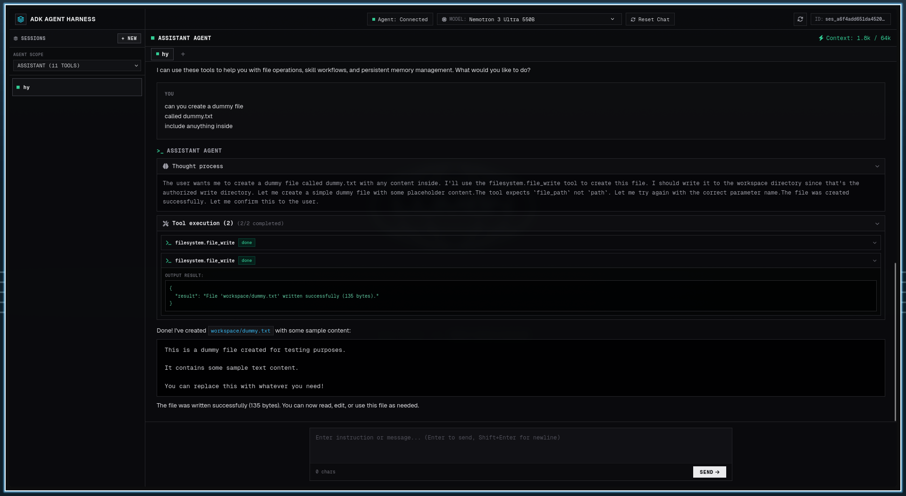

# ADK Agent Harness

A **lightweight, plug-and-play, headless agent harness** built on [Google ADK](https://google.github.io/adk-docs/).

**Why this is different from other harnesses:**

- **Headless by design** — no bundled dashboard, no forced UI. It runs as a pure API server (REST + SSE) you can drive from anything: curl, scripts, CI jobs, cron, web apps, or your own frontend.
- **Lightweight & low memory** — one Python process, SQLite for sessions, zero Node.js/database/Docker requirements. The system prompt is composed dynamically per turn and only 2 tools (`tool_describe` + `tool_run`) are ever registered on the model, so context stays small and token cost stays low.
- **Fully customizable from the system prompt** — agents are plain Python files in `agents/`. Point one at any instructions file (like `AGENTS.md`), pick its model, skills, and tool permissions, and its entire behavior changes. No framework code to touch.
- **Plug-and-play** — drop a Python file in `agents/` and it's live. Drop an MCP server folder in `mcp/` and it's auto-discovered. Register external MCP servers (stdio or SSE) in one JSON file. Switch models at runtime with a single API call.
- **Built for automation agents** — background-safe by default: persistent sessions, zero-trust default-deny permissions with human-approval gates for dangerous actions, and a full audit trail of every tool call in session history.

Spin up a multi-model, tool-using AI agent server with MCP support, workflow skills, persistent memory, and permissions — no UI required.

```
┌─────────────────────────────────────────────────────────────────┐
│                     Any HTTP / SSE Client                       │
│         (curl, scripts, web UIs, other agents, CI jobs)         │
└──────────────────────────┬──────────────────────────────────────┘
                           │ REST + SSE
┌──────────────────────────▼──────────────────────────────────────┐
│                    ADK Agent Harness (:4096)                    │
│  harness/server.py  —  FastAPI: sessions, prompts, approvals    │
│                                                                  │
│  agents/        → pluggable agent definitions (Python)          │
│  models.json    → model catalog (OpenAI, Anthropic, Gemini, …)  │
│  MEMORY.md      → persistent agent memory                       │
│  skills/        → procedural workflows (SKILL.md)               │
│  sessions.db    → persistent session history                    │
└──────────┬───────────────────────────────────┬──────────────────┘
           │ SSE / stdio (MCP protocol)        │
┌──────────▼──────────────┐      ┌─────────────▼─────────────────┐
│  Local MCP Servers      │      │  External MCP Servers         │
│  mcp/*/server.py        │      │  mcp/servers.json registry    │
│  auto-discovered        │      │  (stdio or remote SSE)        │
│  filesystem, memory,    │      │                               │
│  skills                 │      │                               │
└─────────────────────────┘      └───────────────────────────────┘
```

---

## Web UI Preview (Headed Mode)



---

## Features

- **Headless agent server** — FastAPI + Uvicorn, REST + Server-Sent Events streaming.
- **Optional Web Chat UI (Headed Mode)** — zero-dependency browser interface at `http://127.0.0.1:4096/` with live streaming, collapsible thought processes, real-time tool execution cards, token meters, session tabs, and interactive human-approval popups (toggleable via `ADK_ENABLE_WEB_UI`).
- **Pluggable agents** — drop a Python file in `agents/`; each agent has its own instructions, model, skills, and permissions.
- **Multi-model catalog** — switch models at runtime via API. Supports OpenAI-compatible providers (OpenAI, DeepSeek, NVIDIA, Ollama, …) and native Google Gemini through one `models.json` file.
- **MCP support** — auto-discovers local MCP servers in `mcp/*/server.py`, and connects to external stdio or SSE servers listed in `mcp/servers.json`.
- **Skills** — markdown procedure files in `skills/<name>/SKILL.md`, loadable at runtime.
- **Persistent memory** — the agent maintains `MEMORY.md` across sessions via MCP memory tools.
- **Session persistence** — full conversation history stored in SQLite (`sessions.db`).
- **Context compaction** — automatic event summarization at 75% of the model's context limit.
- **Zero-trust permissions** — default-deny tool access with an `allow` / `ask` / `deny` policy per agent; `ask` tools pause for human approval over the API.
- **Sandboxed filesystem tools** — the bundled `filesystem` MCP server only reads/writes inside directories you authorize in `.env`.
- **Live clock injection** — every turn starts with the current date/time in your configured timezone.

---

## Requirements

| Dependency | Version | Notes |
|---|---|---|
| Python | **3.11+** | 3.12 recommended |
| pip / [uv](https://docs.astral.sh/uv/) | latest | uv is auto-detected if installed |
| Git | latest | to clone |
| One LLM API key | — | OpenAI / Anthropic / Gemini / DeepSeek / NVIDIA / local Ollama |

No Node.js, database server, or external services are required. Everything runs locally.

---

## Quick Start

```bash
# 1. Clone / copy the project anywhere
cd adk-agent-harness

# 2. Configure environment
cp .env.example .env
#    → set ADK_MODEL and the matching provider API key (e.g. OPENAI_API_KEY)

# 3. Launch (auto-creates .venv, installs deps, starts MCP servers + agent API)
chmod +x start.sh
./start.sh
```

You'll see:

```
======================================================
  ADK Headless Agent Harness
======================================================
  Workspace:     /path/to/adk-agent-harness
  API Endpoint:  http://127.0.0.1:4096
  Web Chat UI:   http://127.0.0.1:4096/
  Active Model:  openai-gpt4o
  Local MCPs:    SSE starting at http://127.0.0.1:8101/sse
======================================================
```

### Try it

Open **`http://127.0.0.1:4096/`** in your browser to chat immediately, or drive it headlessly via API:

```bash
# 1. Check the server
curl http://127.0.0.1:4096/api/info

# 2. Create a session
curl -X POST http://127.0.0.1:4096/api/session \
  -H "Content-Type: application/json" \
  -d '{"agent": "assistant"}'
# → {"id": "ses_abcd1234...", ...}

# 3. Send a prompt (streamed via SSE)
curl -N -X POST http://127.0.0.1:4096/api/session/ses_abcd1234.../prompt \
  -H "Content-Type: application/json" \
  -d '{"text": "List the files in my workspace and summarize what you see.", "agent": "assistant"}'
```

The agent will call `tool_list` → `tool_run("filesystem.file_list", ...)` and stream back reasoning, tool calls, and text deltas as JSON SSE events.

---

## Configuration

### 1. `.env` (copy from `.env.example`)

Every dynamic value is configurable here — nothing is hardcoded:

```ini
# --- Server ---
AGENT_HOST=127.0.0.1
AGENT_PORT=4096
ADK_ENABLE_WEB_UI=true             # set to false for pure headless API mode without UI
AGENT_SERVER_USERNAME=operator     # optional HTTP Basic Auth user
AGENT_SERVER_PASSWORD=             # set to enable auth on all endpoints
ADK_ALLOWED_ORIGINS=               # comma-separated CORS origins (blank = localhost/private LAN)
ADK_TIMEZONE=UTC                   # IANA timezone injected into every turn

# --- Model (must match a key in models.json) ---
ADK_MODEL=openai-gpt4o

# Provider keys — only the key your ADK_MODEL references is required
OPENAI_API_KEY=your-key
ANTHROPIC_API_KEY=
GEMINI_API_KEY=
DEEPSEEK_API_KEY=
NVIDIA_API_KEY=
OLLAMA_BASE_URL=http://127.0.0.1:11434/v1
OLLAMA_API_KEY=ollama

# --- Sessions / Memory / Compaction ---
ADK_DATABASE_URL=sqlite+aiosqlite:///sessions.db
ADK_COMPACTION_RETENTION_SIZE=15   # last N events kept uncompacted
ADK_MEMORY_FILE=MEMORY.md

# --- MCP ---
MCP_HOST=127.0.0.1
MCP_BASE_PORT=8101                 # local MCP servers auto-assign ports from here (8101, 8102, 8103...)
# MCP_PORT_FILESYSTEM=8101         # optional per-server port overrides
# MCP_PORT_MEMORY=8102
# MCP_PORT_SKILLS=8103

# --- Sandboxed workspace directories (for the filesystem MCP file tools) ---
ADK_WORKSPACE_DIR=workspace
ADK_ARTIFACTS_DIR=artifacts
ADK_TMP_DIR=tmp
# ADK_ALLOWED_READ_DIRS=           # optional comma-separated override
# ADK_ALLOWED_WRITE_DIRS=

# --- Optional path overrides (defaults shown) ---
# ADK_AGENTS_DIR=agents
# ADK_SKILLS_DIR=skills
# ADK_MCP_DIR=mcp
# ADK_MCP_SERVERS_FILE=mcp/servers.json
# ADK_MODELS_FILE=models.json
# ADK_ENV_FILE=.env
```

**Never commit your `.env`** — it's gitignored by default.

### 2. `models.json` — the model catalog

`.env` only names *which* model to use; all provider details live in `models.json`. Edit entries or add your own — every field is user-editable:

```jsonc
{
  "_comment": "See docs below for each field.",
  "models": {
    "my-model-name": {
      "provider":   "openai",                       // label for grouping in API responses
      "model":      "openai/gpt-4o",                // LiteLLM-style id (prefix auto-added if missing)
      "label":      "GPT-4o",                       // display name
      "base_url":   "https://api.openai.com/v1",    // endpoint
      "api_key":    "${OPENAI_API_KEY}",            // ${VAR} expanded from .env
      "temperature": 0.2,                           // sampling temperature
      "context_limit": 128000,                      // tokens; drives compaction threshold
      "max_output_tokens": 16384,                   // optional output cap
      "transport":  "litellm"                       // "litellm" (OpenAI-compatible) | "gemini-rest" (native Gemini)
    }
  }
}
```

Bundled examples: `openai-gpt4o`, `anthropic-sonnet`, `gemini-flash`, `deepseek-chat`, `nvidia-nemotron`, and `ollama-local` (free/local). Each is only usable when its `${VAR}` key is set in `.env` — the harness fails fast, never falls back silently.

### 3. `agents/` — define your agents

Each `.py` file in `agents/` defines one agent. The bundled default **`assistant`** shows every editable field:

```python
from pathlib import Path
from harness.schema import AgentDefinition

# Point instructions at any file you like — AGENTS.md, a txt, or an inline string
INSTRUCTIONS = (Path(__file__).resolve().parent.parent / "AGENTS.md").read_text(encoding="utf-8").strip()

agent = AgentDefinition(
    name="assistant",                       # unique id used in API calls
    description="General-purpose ...",      # shown in /api/agents
    instructions=INSTRUCTIONS,              # the agent's system prompt (required, non-empty)
    model=None,                             # None = use ADK_MODEL from .env, or name a models.json entry
    skills=["workspace-basics"],            # folder names inside skills/ (must exist)
    permissions={
        "allow": [                          # run immediately, no approval
            "filesystem.file_read", "filesystem.file_glob", "filesystem.file_list",
            "filesystem.file_write", "filesystem.file_edit",
            "skills.skill_list", "skills.skill_load",
            "memory.memory_read", "memory.memory_write", "memory.memory_edit",
        ],
        "ask": [                            # pause until a human approves via API
            "filesystem.file_delete",
        ],
        # "deny": ["filesystem.file_write"], # optional hard block; unmatched tools are denied anyway
    },
)
```

**Rules enforced at startup (fail-fast, zero fallback):**
- `server.tool_name` must reference an MCP server that exists and a tool that exists on it.
- Every local tool listed must declare `meta={"summary": "..."}` in its MCP server.
- Every skill must have a `skills/<name>/SKILL.md`.
- Requests must always name an agent explicitly (`agent` in body, query, or `X-Agent` header) — there is no default agent.

### 4. `mcp/servers.json` — external MCP servers

Local MCP servers in `mcp/*/server.py` are **discovered automatically**. To add external ones, edit `mcp/servers.json`:

```jsonc
{
  "mcpServers": {
    "my-remote": {                          // becomes the tool prefix: "my-remote.tool_x"
      "transport": "sse",
      "url": "http://127.0.0.1:9000/sse",   // ${VAR} supported
      "description": "Remote SSE MCP"
    },
    "my-stdio": {
      "transport": "stdio",
      "command": "npx",
      "args": ["-y", "@modelcontextprotocol/server-everything"],
      "cwd": "/optional/working/dir",
      "env": {"API_KEY": "${MY_API_KEY}"}   // ${VAR} supported
    },
    "old-server": { "disabled": true }      // hide an auto-discovered local server
  }
}
```

### 5. Writing your own MCP server

Create a folder with a `server.py` exposing tools, and it joins the mesh automatically:

```python
# mcp/weather/server.py
from mcp.server.mcpserver import MCPServer

mcp = MCPServer(name="weather", title="Weather Tools", version="1.0.0")

@mcp.tool(meta={"summary": "Get current weather for a city"})
def weather_get(city: str) -> dict:
    """Fetch current weather."""
    return {"city": city, "temp_c": 21}

def main():
    mcp.run("sse", host="127.0.0.1", port=8102)

if __name__ == "__main__":
    main()
```

Then grant it in your agent: `"allow": ["weather.weather_get"]`.

---

## Directory Layout

```
adk-agent-harness/
├── harness/                # The portable harness core (domain-agnostic)
│   ├── server.py           #   FastAPI: sessions, prompts (SSE), approvals, model switch
│   ├── loader.py           #   Discovers agents/ and builds scoped ADK LlmAgents
│   ├── runner.py           #   ADK Runner orchestration + streaming
│   ├── permissions.py      #   Zero-trust allow/ask/deny engine + approval registry
│   ├── config.py           #   .env-driven configuration
│   ├── models.py           #   models.json catalog with ${VAR} secret expansion
│   ├── compaction.py       #   Context compaction (75% of context_limit)
│   ├── events.py           #   ADK event → SSE chunk serialization
│   ├── sessions.py         #   SQLite session persistence
│   ├── mcp/manager.py      #   MCP client manager (SSE + stdio, local + external)
│   └── providers/model.py  #   ModelSpec → LiteLlm / Gemini factory
├── agents/                 # YOUR agent definitions (assistant.py included)
├── skills/                 # Workflow procedures (workspace-basics/SKILL.md included)
├── mcp/
│   ├── filesystem/server.py # Bundled MCP: sandboxed file read/write/edit/delete/list
│   ├── memory/server.py     # Bundled MCP: persistent memory read/write/edit
│   ├── skills/server.py     # Bundled MCP: procedure list/load tools
│   ├── servers.json        # External MCP registry
│   └── run_all.py          # Local MCP SSE launcher (--status, --export-config)
├── workspace/              # Agent's working files (sandboxed read/write)
├── artifacts/              # Generated deliverables (sandboxed read/write)
├── tmp/                    # Scratch space (sandboxed read/write)
├── tests/                  # test_permissions.py, test_fallback.py, test_e2e.py
├── models.json             # Model catalog (edit me)
├── .env.example            # Environment template (copy to .env)
├── MEMORY.md               # Persistent agent memory (edit via tools or by hand)
├── AGENTS.md               # Default system instructions for the assistant agent
├── start.sh                # One-command launcher
├── preview.png             # Web UI screenshot preview
└── pyproject.toml / requirements.txt
```

---

## API Reference

All endpoints return JSON; prompt endpoints stream `text/event-stream` SSE. When `AGENT_SERVER_PASSWORD` is set, every request needs `Authorization: Basic <base64(user:pass)>`.

| Method | Path | Description |
|---|---|---|
| GET | `/api/info` | Health, version, active model, agent list |
| GET | `/api/agents` | Loaded agents with tools & skills |
| GET | `/api/mcp` | Discovered MCP servers + connection status |
| GET | `/api/model` | Model catalog grouped by provider |
| POST | `/api/model` | Switch active model `{"model": "..."}` |
| POST | `/api/session` | Create session `{"agent": "...", "title": "..."}` |
| DELETE | `/api/session/{id}?agent=...` | Delete session |
| GET | `/api/session/active` | Currently running session IDs |
| GET | `/api/session/{id}/message?agent=...` | Full message history |
| GET | `/api/session/{id}/usage?agent=...` | Token usage stats |
| POST | `/api/session/{id}/prompt` | Stream a prompt turn (SSE) |
| POST | `/api/session/{id}/abort` | Abort a running turn |
| GET | `/api/permissions` | Pending approval requests |
| POST | `/api/session/{id}/approval` | Resolve approval `{"requestId": "...", "decision": "approved"\|"rejected"}` |

**SSE event contract** (one JSON object per `data:` line):

```jsonc
{"type": "delta", "field": "text"|"reasoning", "text": "..."}
{"type": "tool", "callId": "...", "tool": "filesystem.file_read", "state": "running"|"complete", "input": {...}, "output": {...}}
{"type": "usage", "promptTokens": ..., "contextTokens": ..., "contextLimit": ...}
{"type": "permission", "requestId": "...", "action": "filesystem.file_delete", "hint": "...", "resources": [...]}
{"type": "error", "error": "..."}
{"type": "done"}
```

**Approval flow:** an `ask`-tier tool pauses the turn → client receives a `permission` event → client POSTs to `/api/session/{id}/approval` → the turn resumes streaming on that same response. Approvals are single-use and expire after 5 minutes.

---

## Bundled Local MCP Servers

The harness bundles modular, focused micro-MCP servers inside `mcp/` that run concurrently on SSE and are auto-discovered:

### 1. `filesystem` (default port 8101)

| Tool | Tier | Description |
|---|---|---|
| `filesystem.file_read` | allow | Read lines from `workspace/`, `artifacts/`, `tmp/` |
| `filesystem.file_glob` | allow | Glob search inside authorized dirs |
| `filesystem.file_list` | allow | List directory contents |
| `filesystem.file_write` | allow | Write files (optional overwrite) |
| `filesystem.file_edit` | allow | Exact find-and-replace |
| `filesystem.file_delete` | **ask** | Delete a regular file (human approval) |

Path access is enforced inside the server itself against `ADK_ALLOWED_*_DIRS` from `.env` — symlinks are refused, `.env` and source files are unreachable.

### 2. `memory` (default port 8102)

| Tool | Tier | Description |
|---|---|---|
| `memory.memory_read` | allow | Read `MEMORY.md` |
| `memory.memory_write` | allow | Atomically overwrite `MEMORY.md` |
| `memory.memory_edit` | allow | Exact find-and-replace in `MEMORY.md` |

*(Tip: To disable persistent memory for an agent, simply omit `memory.*` tools from its permissions in `agents/*.py` or remove `mcp/memory`.)*

### 3. `skills` (default port 8103)

| Tool | Tier | Description |
|---|---|---|
| `skills.skill_list` | allow | List available skills in `skills/` |
| `skills.skill_load` | allow | Load a `SKILL.md` into context |

---

## Skills & Memory

**Skills** are just markdown with YAML frontmatter in `skills/<name>/SKILL.md`:

```markdown
---
name: my-skill
description: One-line summary shown to the agent.
---
# Procedure
1. Step one...
```

List them via `skills.skill_list`, load via `skills.skill_load` — or grant specific skills to an agent so their summaries are injected into the system prompt.

**Memory** lives in `MEMORY.md`. The agent reads and updates it with `memory.memory_*` tools; you can also edit it by hand. Keep it concise and never store secrets in it.

---

## Tests

```bash
./start.sh            # once, to provision .venv

.venv/bin/python tests/test_fallback.py     # config fail-fast behavior
.venv/bin/python tests/test_permissions.py  # zero-trust permission engine
.venv/bin/python tests/test_e2e.py          # full API + MCP + security suite
```

---

## Security Notes

- **Default deny everywhere**: agents can only call explicitly allowed tools; `ask` tools require a live human approval token; unmatched paths are refused.
- **No secrets in code**: API keys live only in `.env` and are referenced as `${VAR}` from `models.json` / `mcp/servers.json`. `.env`, tokens, keys, and DBs are gitignored.
- **Timing-safe auth**: HTTP Basic Auth uses `secrets.compare_digest`; CORS defaults to loopback/private networks only.
- **Sandboxed file tools**: the `filesystem` server cannot touch anything outside your configured directories.

## License

MIT — see [LICENSE](LICENSE).
